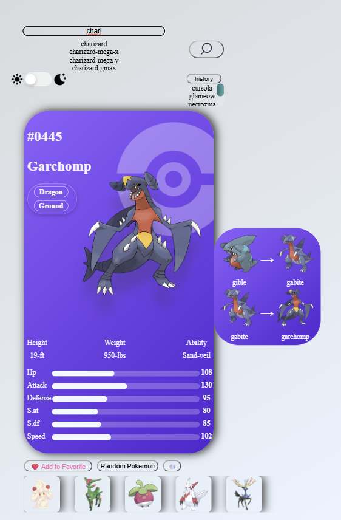
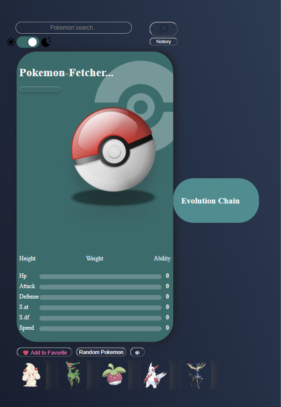
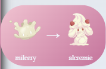

# Pokédex — Interactive Pokémon Fetcher


A responsive Pokémon dashboard built with HTML, CSS, and JavaScript using the PokéAPI.
The application allows users to search for Pokémon, explore their stats and evolution chains, save favorites, view search history, generate random Pokémon, and switch between light and dark themes.

## Table of Contents

- Preview
- Features
- Tech Stack
- Project Structure
- GitHub
- Setup
- Usage
- Learning
- Why I Built This Project
- Future Improvement

## Preview

### Dashboard



### Dark Mode



### Evolution Chain



## Features

- Search Pokémon by name or ID with live suggestions
- Search history and favorites (persisted in localStorage)
- Main Pokemon card with dynamic color themes
- Evolution chain viewer with hover animations
- Light/Dark theme toggle 
- Favorites System 
- Random Pokémon generator

## Tech Stack

- HTML, CSS, JavaScript
- PokéAPI (REST)
- localStorage for simple persistence

## Project Structure

```text
Pokemon/
├── index.html
├── README.md
├── .vscode/
└── src/
	├── assets/
	│   ├── gifts/
	│   │   ├── madpikachu1.gif
	│   │   └── spinningpokeball.gif
	│   └── images/
	│       ├── moonicon2.png
	│       ├── pokebal2.jpg
	│       ├── pokeball.jpg
	│       ├── pokemon-background.jpg
	│       ├── pokemon5.jpg
	│       ├── pokemon5.png
	│       ├── search.png
	│       └── sunicon2.png
	├── css/
	│   ├── dashboard.css
	│   ├── global.css
	│   └── theme.css
	└── js/
		├── api.js
		├── evolution.js
		├── favorites.js
		├── main.js
		└── theme.js
```

### Main Files

- `index.html` — application markup and asset references
- `src/css/global.css` — global layout variables and page styles
- `src/css/theme.css` — light and dark theme styles
- `src/css/dashboard.css` — dashboard, search, evolution, and favorites styles
- `src/js/main.js` — application startup and event listeners
- `src/js/api.js` — PokéAPI requests and Pokémon data display
- `src/js/evolution.js` — evolution chain requests and rendering
- `src/js/favorites.js` — favorites, random Pokémon, and search history
- `src/js/theme.js` — theme toggle behavior
- `src/assets/images/` — dashboard images and icons
- `src/assets/gifts/` — loading and Pokémon GIFs

## GitHub

Repository: [reynox-otn/pokemon-dashboard](https://github.com/reynox-otn/pokemon-dashboard)

## Setup

Recommended: run a local static server (module scripts require HTTP). From the `Pokemon` folder:

```bash
python -m http.server 8000
# then open: http://localhost:8000/index.html
```

You can also open `index.html` directly in your browser, but some features may require an HTTP environment.

## Usage

1. Open the app in your browser.
2. Search by Pokémon name or ID in the search box.
3. Use the history button to view previous searches; click a history item to reload its details.
4. Click the search icon or press ENTER to load stats, details, and the evolution chain.
5. Use the favorite button to save Pokémon to your favorites bar.
6. Toggle the theme to switch between light and dark modes.
7. Use the random button to generate a random Pokemon.

# Learning

- How to structure a multi‑component frontend project
- How to work with REST APIs efficiently
- How to design responsive layouts using clamp() and media queries
- How to create  polished UI animations
- How to manage state with localStorage
- How to write clean, maintainable JavaScript
- How to work with asynchronous JavaScript using fetch()
- How to use async/await with REST APIs
- How to manipulate and update the DOM dynamically

## Why I Built This Project

Pokémon was one of the shows that helped me improve my English listening skills.
Since I already had a personal connection with Pokémon, I wanted to turn that interest into a programming project.
I decided to build a Pokédex so I could practice working with REST APIs, asynchronous JavaScript, DOM manipulation, responsive CSS, and browser storage while building something I actually enjoyed.

# Future Improvements
- Add Pokémon moves + descriptions
- Add filtering by type
- Add “compare Pokémon” feature
- Add a battle mode